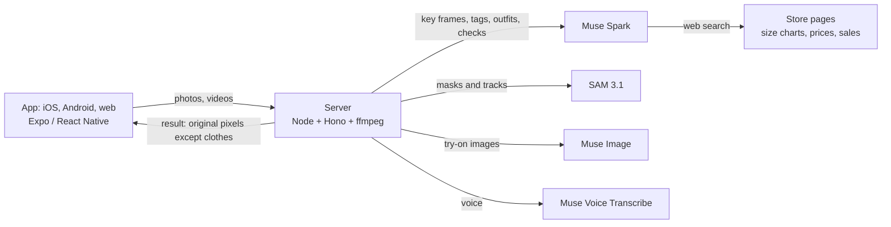

# Twin Closet

**See any piece on your real body, styled with what you already own, before you buy.**

Scan yourself once and film your closet. Then screenshot a piece from any store, or snap it in the shop:
Twin Closet tells you whether you already own something like it, builds outfits with your own clothes and shows
them on you from four angles. Your face, hair and hands are never generated: they stay your real pixels.

Built for the Meta Global AI Developer Hackathon (Indie track) on SAM 3.1, Muse Spark, Muse Image and
Muse Voice Transcribe.

## Try it as a judge (from a laptop)

**Web version: https://twin-closet.vercel.app** (API: https://twin-closet-api.onrender.com/health)

On a laptop a guide for judges sits next to the app: what to try, which Meta model does each step and whether
the models are live right now.

1. Tap **Explore the demo account**. You land on **Try on**: the demo person already has a closet, a body scan,
   measurements and a style profile, and two pieces are waiting to be tried.
2. **Drop a screenshot** of any piece from any store onto the page. It is cut out, read and compared with the closet.
3. **See it on me**: compare your clothes and the try-on with the slider, turn the angle dial, then tap **Fit** —
   how the piece sits zone by zone (waist, hips, length…) and next to a favourite pair you already own.
4. **Scan → Scan with your phone**: a QR code opens the same closet on your phone (any phone, in the browser,
   nothing to install). Film your rail or a slow spin there — the steps run on your laptop screen, each labelled
   with the Meta model doing it. No phone at hand: **Use sample video**.
5. **Me**: the style quiz (61 styles) and your measurements. **Set up my measurements and style** on the first
   screen walks through both from the start.

On an iPhone, **Share → Add to Home Screen** opens it full screen like an app. Android: the APK from the Expo build
also takes **Share → Twin Closet** from Instagram or a store app.

Demo limits keep the hackathon credits safe: a few uploads per hour and model jobs per day per visitor;
sample results are cached and free.

## What each Meta model does

| Step | Model | Job |
|---|---|---|
| Closet scan | **Muse Spark** | finds every piece on key frames of the video, with boxes |
| | **SAM 3.1** (video) | tracks each piece through the video, cuts out its best frame |
| | **Muse Spark** | tags each piece (kind, colour, fabric, fit) and merges duplicates |
| Body scan | **Muse Spark** | picks front, 3/4, side and back frames from a 6-second spin |
| | **SAM 3.1** | masks the person, face, hair, hands and current clothes |
| New piece | **SAM 3.1** | cuts the piece out of a screenshot or an in-store photo |
| | **Muse Spark** | reads brand, REF, price, sale price, size and fabric from the tag |
| | **Muse Spark** + web search | finds the same piece online in the person's country |
| "You already own this" | **Muse Spark** | compares the new piece with the closet |
| Fit | **Muse Spark** + web search | reads the size chart, cut and fabric from the product page |
| | **SAM 3.1** | measures a favourite piece laid flat next to an A4 sheet |
| Style | **Muse Spark** | reads the style of the person's own outfit photos (Pinterest, gallery) |
| Outfits | **Muse Spark** | builds 3 looks from the new piece and the closet, in the person's style |
| Try-on | **Muse Image** | dresses the person's photo, image search turned off |
| | **SAM 3.1** | masks the result so face, hair and hands are pasted back from the original |
| | **Muse Spark** | checks the result: same person, same pose, garment matches, no seams |
| Price drops | **Muse Spark** + web search | daily "is the store on sale?" and wishlist prices |
| Twin, the stylist | **Muse Spark** (tools) | outfits from the closet, wishlist and favourite stores |
| | **Muse Voice Transcribe** | voice input in the chat |

Not a Meta model: the live coach in the body scan (pose, distance, light, stillness) runs on the device with
MediaPipe Pose, so the camera takes the four photos by itself and nothing is uploaded until they are good.



## How the face and hands stay real

Muse Image redraws the whole picture, so protection is built around it, not asked of it
(`server/src/tryon/compose.ts`):

1. SAM 3.1 masks the person, face, hair and hands on the original photo and the person and new clothes on the result.
2. The result is aligned to the photo by silhouette and the uncovered body; a result whose pose changed is rejected.
3. Clothing zone = old clothes ∪ new clothes − face, hair and hands.
4. Colour is matched on a band around the zone (the face is left out: the model may have changed it), and the
   result is pasted into the original with a soft edge. Everything outside the zone is the original photo.

Tested on synthetic scenes (alignment, untouched protected pixels, colour cast, a jacket over bare arms, a changed pose)
and on real photos: `npm run demo:compose -w @twin/server`.

## Privacy and data

- The Meta key lives only on the server.
- Uploaded photos, videos and key frames are deleted after 48 hours, on the server and in its private Supabase bucket;
  sample results stay as a cache.
- Each device keeps its own wishlist on the server; accounts with owner-only access (Supabase RLS) are prepared
  in `supabase/migrations/`.
- Product data comes only from the user's own photos and from Muse Spark search results. The app does not scrape store
  websites or call their private APIs. Live stores: Zara, Bershka, Pull & Bear, ASOS, Zalando, H&M, Shein, AliExpress
  and Temu (`packages/shared/src/stores.ts`); other brands are in the list and coming soon.

## Built and working now

- **Fit by zones, never one size label** — room at chest, waist, hips, length and leg for each piece, a verdict
  ("fits, with one catch"), the size that fixes it, and a comparison with a favourite piece you own
  (`packages/shared/src/fit.ts`). Coloured labels sit on the try-on. Sizes S/M/L appear only if you turn them on.
  Tap any piece in the closet to mark it "fits me perfectly" and measure it flat with a tape — new pieces of that
  kind are compared with it.
- **Measurements, optional** — height alone is enough; the rest sharpens the fit. Private, deleted from Me.
- **Style quiz** — 61 styles in 13 families, from everyday casual and smart casual to old money, poetcore, gorpcore and Y3K, men's and women's looks;
  a profile of 1–3 styles with weights, colours and what to leave out goes into outfits and Twin
  (`packages/shared/src/style.ts`).
- **Smart body and piece scan** — a live coach on the device: full body in frame, distance, centre, arms, angle, light
  and stillness, then the photo takes itself; pieces front → back → label, the in-store tag sharper still
  (`packages/shared/src/scan.ts`).
- **Wishlist and price drops** — favourite stores by country, sale mode, a second check before a drop counts,
  90-day price history and your own target price.
- **Online and cheap stores** — ASOS, Zalando (every country site), H&M, Shein, AliExpress and Temu next to Zara;
  a pasted product link is recognised with its item number, and cheap stores warn that sizes run small.
- **Judges' path** — demo account, the laptop guide, continue on your phone by QR, demo limits. The sample videos
  for "Use sample video" are filmed and cached once the key arrives.

## Status

Built and tested now: everything above, uploads and jobs with steps, video to H.264 and key frames, try-on
compositing, store search and sale checks on Muse Spark, demo limits, 48-hour cleanup.
Every model step is wired and tested on a fake Meta API (`server/src/pipeline/`, `server/test/pipeline.test.ts`):
a new piece (Spark reads it → SAM cuts it out → Spark finds it in the store → Spark compares with the closet),
the closet video (Spark boxes → SAM video track with our object ids → best-frame cut-outs → Spark tags and merges
duplicates), the body scan (Spark picks the angles → SAM masks person, face, hair, hands and clothes), the try-on
(Muse Image → SAM masks on both → compositing → Spark check), Twin's tool loop (`POST /twin`) and outfits (`POST /looks`).
What is left for the key: checking the live answer formats against these. Until then the app says so at the step that
needs the key, and the laptop guide shows "waiting for the hackathon API key".

## Built during the hackathon

The building period was 27 October – 4 November 2026 (kickoff on 26 October). Before the kickoff, on 25 October, the
repository got only a skeleton (the Expo starter app, a 25-line Hono server, a first draft of the Meta API client and
shared types) and design and planning notes
(`docs/`, `PLAN.md`) — 8 commits. Every feature in this README was built from 27 October on; the full history is in
the commit log.

## Code

- `app/` — Expo (React Native) app: iOS, Android and web from one codebase. Design system "Noir" (`docs/design.md`).
- `server/` — Node + Hono API: uploads, jobs with steps, ffmpeg, try-on compositing, price watch, demo limits.
  Model prompts and strict JSON schemas: `server/src/models/`. State and files live in Supabase (private table and
  bucket, `supabase/migrations/0002_server_state.sql`), so a redeploy loses nothing; without Supabase it keeps them in
  `server/data`. Sized for a 512 MB instance: uploads stream to disk, ffmpeg runs on two threads, one heavy job at a time.
- `packages/shared/` — types shared by app and server.

## Run

```bash
npm install
cp server/.env.example server/.env   # add MODEL_API_KEY
npm run server                        # http://localhost:8787
npm run app                           # Expo dev server; open in Expo Go or press w for web
npm test -w @twin/server              # server tests (needs ffmpeg in PATH)
```

On a phone (Expo Go, same Wi-Fi as the computer): put the computer's Wi-Fi address into `app/.env.local`
(not committed), run `npm run app -- --go`, then scan the QR code or open `exp://<address>:<port>` in Expo Go.
Sharing from Instagram or a store app ("Share → Twin Closet") needs an installed build, not Expo Go:
`npx eas-cli build --profile preview --platform android` gives an APK (`app/eas.json`).

```bash
EXPO_PUBLIC_API_URL=http://192.168.1.20:8787
REACT_NATIVE_PACKAGER_HOSTNAME=192.168.1.20
```

Web build for judges: `TWIN_API_URL=https://<server> npm run build:web -w @twin/app` (local `.env` files are ignored).

Plan and decisions (in Russian): [PLAN.md](PLAN.md).

## License

MIT, see [LICENSE](LICENSE). The brand list keeps its own BSD 3-Clause license (below).

## Credits

Brand list: [Name Suggestion Index](https://github.com/osmlab/name-suggestion-index) by OpenStreetMap contributors,
BSD 3-Clause. Demo photos in `app/assets/demo` are generated for the mockups.
